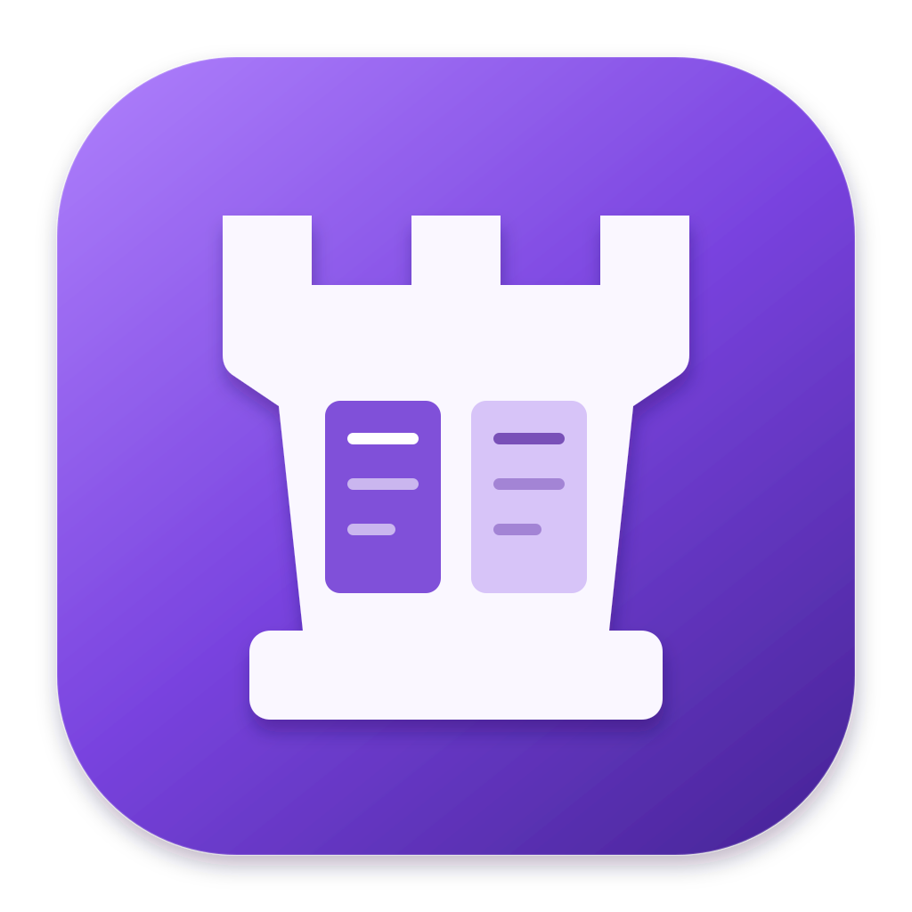

# PaneRook

Ein nativer macOS-Dateimanager, inspiriert von Midnight Commander. Zwei unabhängige Panels, direkte Tastaturbedienung und native macOS-Integration. Swift + AppKit, mit Sparkle für App-Updates, ohne eingebettetes Terminal.

## Download

[Projektseite](https://frankhildebrandt.github.io/panerook/) · [Release 0.3.0](https://github.com/frankhildebrandt/panerook/releases/tag/v0.3.0)

Release **0.3.0** öffnet Remote-Verbindungen im ausgewählten Panel und bietet einen gemeinsamen Einstellungsdialog mit Themes und frei belegbaren Tastenkürzeln. PaneRook unterstützt Apple Silicon und Intel ab macOS 14. Installation und Bedienung stehen in der [Dokumentation](https://frankhildebrandt.github.io/panerook/dokumentation/).

## Starten

Voraussetzungen: macOS 14 oder neuer und Xcode 26 oder neuer mit ausgewählter Command Line Toolchain.

```sh
make dev
```

Das Makefile bietet folgende Targets:

| Aufruf | Aktion |
| --- | --- |
| `make run` | Optimiertes App-Bundle bauen und starten |
| `make dev` | Debug-App starten, Änderungen beobachten und nach erfolgreichem Build neu starten |
| `make build` | Optimiertes App-Bundle unter `build/PaneRook.app` bauen (auch Standard für `make`) |
| `make test` | Swift-Tests und Appcast-Prüfung ausführen |
| `make clean` | SwiftPM-Buildprodukte und den Ordner `build/` entfernen |

Die Build-Targets verwenden `scripts/build-app.sh`.
`make dev` prüft im Sekundentakt `Sources/`, `Resources/`, `scripts/`, das Makefile sowie `Package.swift` und `Package.resolved`, ohne zusätzliche Watcher-Abhängigkeit. Bei Buildfehlern läuft die zuletzt gestartete App weiter; die nächste Änderung löst einen neuen Versuch aus. `Ctrl-C` beendet den Watcher und die von ihm gestartete App. Beim Neustart wird diese App beendet; laufende Dateioperationen vorher abschließen.

Für Entwicklung in Xcode: `open Package.swift`, Scheme **PaneRook** ausführen. Das Skript erzeugt zusätzlich das eigentliche App-Bundle und signiert es ohne weitere Konfiguration lokal ad hoc.

SwiftPM lädt die festgelegte Sparkle-Version **2.10.0** beim ersten Build. Das Buildskript bettet das Framework und seine Helfer in das App-Bundle ein und signiert sie. Ohne `PANEROOK_SPARKLE_PUBLIC_KEY` bleiben Update-Funktionen im Entwicklungsbuild deaktiviert; das gilt auch beim Start des bloßen SwiftPM-Executables.

Für ein Universal-DMG und ein Universal-ZIP inklusive eigener SHA-256-Prüfsummen:

```sh
./scripts/package-release.sh
```

Die Pakete liegen unter `build/release/`. Das DMG enthält `PaneRook.app` und eine Verknüpfung zum Programme-Ordner. Das Skript baut beide Architekturen und prüft die App-Signatur sowie das Disk-Image. Eine optionale Versionsangabe (`./scripts/package-release.sh 0.3.0`) muss mit `Resources/Info.plist` übereinstimmen.

Für das Paketieren müssen zusätzlich `PANEROOK_SPARKLE_PUBLIC_KEY` und `PANEROOK_SPARKLE_PRIVATE_KEY` gesetzt sein. Die einmalige Einrichtung steht unter [Update-Signierung](docs/signing.md#sparkle-update-signierung). Das Skript erstellt außerdem `appcast.xml` für GitHub Releases und prüft, dass Update-Signatur und eingebetteter öffentlicher Schlüssel zusammenpassen.

Für Release-Builds ist ein **Developer ID Application**-Zertifikat für **Frank Hildebrandt (4R24354Z88)** eingerichtet. Der zugehörige private Schlüssel und der eigene Schlüsselbund liegen verschlüsselt außerhalb des Repositorys unter `~/Library/Application Support/PaneRook/Signing/DeveloperID/`. Für einen lokalen Build mit dieser Identität:

```sh
signing_directory="$HOME/Library/Application Support/PaneRook/Signing/DeveloperID"
security unlock-keychain -p "$(cat "$signing_directory/keychain-password.txt")" \
  "$signing_directory/signing.keychain-db"
PANEROOK_SIGNING_IDENTITY="$(cat "$signing_directory/identity.txt")" \
PANEROOK_SIGNING_KEYCHAIN="$signing_directory/signing.keychain-db" \
PANEROOK_SIGNING_TIMESTAMP=secure \
PANEROOK_NOTARY_PROFILE=panerook-notary \
PANEROOK_NOTARY_KEYCHAIN="$signing_directory/signing.keychain-db" \
./scripts/package-release.sh
```

Mit konfigurierten Apple-Zugangsdaten kann der Release-Workflow App und DMG notarisieren und die Tickets anheften. Einrichtung, verschlüsselte Sicherung, Zertifikatserneuerung und die optionale persönliche Signatur stehen unter [Signierung und Releases](docs/signing.md).

```sh
make test
```

In einer Umgebung, die verschachtelte Build-Sandboxen verhindert:

```sh
PANEROOK_DISABLE_BUILD_SANDBOX=1 make dev
PANEROOK_DISABLE_BUILD_SANDBOX=1 make test
```

Falls die Umgebung das Erzeugen von dSYM-Dateien verhindert, lässt sich zusätzlich `PANEROOK_DISABLE_DEBUG_SYMBOLS=1` setzen. Das App-Bundle wird dann ohne separate Debug-Symbole erstellt.

## Projektseite und Releases

Die statische Website liegt unter `website/` und wird mit Astro gebaut. Neben der Produktseite mit App-Screenshots gibt es eine [Dokumentation für Installation und Nutzung](https://frankhildebrandt.github.io/panerook/dokumentation/) sowie [Release Notes](https://frankhildebrandt.github.io/panerook/release-notes/). Alle Seiten verwenden dieselbe Hauptnavigation.

```sh
cd website
npm ci
npm run build
```

`astro.config.mjs` setzt `site` auf `https://frankhildebrandt.github.io` und `base` auf `/panerook`. Die Release-Notes-Seite übernimmt die versionierten Markdown-Dateien aus `docs/releases/` automatisch und sortiert sie absteigend nach Version. Der Workflow `.github/workflows/pages.yml` veröffentlicht Änderungen an der Website oder diesen Release-Dateien auf `main` über GitHub Actions auf GitHub Pages. In den Repository-Einstellungen muss **Pages → Source → GitHub Actions** aktiviert sein.

Der Workflow `.github/workflows/release.yml` testet die App auf einem macOS-Runner und signiert App und DMG mit der in GitHub-Secrets hinterlegten Developer-ID-Identität. Mit vollständigen Apple-Notarisierungs-Secrets übermittelt er beide an Apple und heftet die Tickets an. Ohne vollständige Signierkonfiguration bricht er ab. Ein Tag `v<Version>` veröffentlicht anschließend ein GitHub-Release mit Universal-DMG, Universal-ZIP und den jeweiligen SHA-256-Prüfsummen; die Version muss zum App-Bundle passen. Release-Hinweise liegen optional unter `docs/releases/<Version>.md`. Über **Run workflow** lässt sich der Build auch ohne Veröffentlichung als Actions-Artefakt ausführen. Release 0.1.1 ist die erste signierte und notarisierte Ausgabe mit DMG und ZIP.

## App-Updates

**PaneRook → Nach Updates suchen …** prüft manuell auf eine neuere Version. Standardmäßig prüft die App außerdem einmal täglich im Hintergrund. Unter **PaneRook → Einstellungen … → Updates** lassen sich die automatischen Prüfungen und das automatische Herunterladen und Installieren einstellen. Automatische Installation ist zunächst ausgeschaltet; Sparkle speichert die gewählte Einstellung für spätere Starts.

Der Feed liegt als `appcast.xml` beim [neuesten stabilen GitHub Release](https://github.com/frankhildebrandt/panerook/releases/latest). Downloads laufen über HTTPS; Sparkle prüft die Ed25519-Signatur des Update-ZIPs vor dem Entpacken. Vorabversionen werden über diesen Feed nicht angeboten. Die App sollte im Programme-Ordner liegen, nicht im geöffneten DMG.

Für Releases sind die zusätzlichen GitHub-Secrets `PANEROOK_SPARKLE_PUBLIC_KEY` und `PANEROOK_SPARKLE_PRIVATE_KEY` einzurichten. Jede neue Ausgabe braucht eine höhere `CFBundleVersion` sowie eine passende `CFBundleShortVersionString` in `Resources/Info.plist`. Bestehende Installationen von **0.1.1** müssen **0.2.0** als erste Ausgabe mit Updater einmal manuell installieren; anschließend sind Updates in der App möglich.

## Funktionsstand

- Zwei native Dateilisten mit Systemicons, Größe, Datum, Sortierung und vollständigem oder kompaktem Listenformat. Pfade verstehen absolute und relative Angaben sowie `~`; Verlauf, Hotlist und Finder-Anbindung ergänzen die Navigation.
- Git-Repository-Ordner zeigen bereits im übergeordneten Verzeichnis ihren Branch und Status neben dem Namen: **✓** sauber, **●** Änderungen oder unversionierte Einträge, **!** Konflikte. **↑/↓** geben lokale Commit-Abstände zum bekannten Upstream an. Ein Tooltip schlüsselt vorgemerkte und übrige Änderungen auf. Die Anzeige funktioniert auch im kompakten Listenformat und für Worktrees; sie wird im Hintergrund beim Laden und Aktualisieren (**⌘R**) der Ordnerliste ermittelt, ohne Netzwerkzugriff.
- Pro Panel: Dateiliste, Schnellansicht, Info oder ein beim Aufklappen nachgeladener Verzeichnisbaum. Schnellansicht und Info folgen der Auswahl des anderen Panels. Dateimasken filtern Dateien; Ordner bleiben zum Navigieren sichtbar. Gruppen lassen sich per Maske markieren, abwählen oder umkehren.
- Git-Repositories mit Branch-/Statusanzeige in beiden Panels, Statusfiltern und gespeicherten Watched-Markierungen. Ein eigenes Git-Fenster bietet Diffs, Staging, Commits, Branch- und Versionswechsel, Stashes, Tags und Remote-Abgleich.
- ZIP-, TAR- und tar.gz-/TGZ-Archive als virtuelle Ordner direkt in den Hauptpanels: Unterordner öffnen, Dateien hinein- und herauskopieren, verschieben/umbenennen, Ordner anlegen und Einträge löschen.
- Rekursives Kopieren/Verschieben mit Datei-/Gesamtfortschritt und Abbruch, neue Ordner, Papierkorb, harte und symbolische Links einschließlich relativer Links und Linkzielbearbeitung. Chmod und Chown arbeiten mit den Benutzerrechten von macOS; Chmod unterstützt gemischte Mehrfachauswahlen und Sonderbits.
- Rekursive Datei- und Textsuche mit Übernahme der Treffer ins Panel, byteweise Datei- und Verzeichnisvergleiche sowie berechnete Ordnergrößen. Diese Werkzeuge laufen in abbrechbaren Ergebnisfenstern.
- Quick Look, eingebaute Textvorschau mit wählbarer Codierung, Bearbeiten über TextEdit und Öffnen mit der Standard-App oder einer konfigurierten App-Zuordnung.
- Gemeinsame Aufgaben-Queue für Dateiaktionen, Suche, Vergleiche, Ordnergrößen, Shell-Befehle und Remote-Transfers: Fortschritt, Hintergrundmodus, Abbruch und erneut aufrufbare Ergebnisse. Benutzermenü, Befehls-/Dateichronik und eine Liste der geöffneten App-Fenster ergänzen den Ablauf.
- FTP, SSH-Shell, SFTP und Nextcloud (WebDAV über HTTPS) mit Remote-Browser im gewählten Panel für Navigation, Upload, Download, Ordner und Löschen; Details und Grenzen stehen unten.
- Native MC-Menükategorien „Links · Datei · Befehl · Optionen · Rechts“. F9 und das Menü-Symbol öffnen dieselben Kategorien im Fenster. Einstellungen steuern Layout, Zeilenhöhe, Symbole, Auswahlstatus, Rückfragen, Hell/Dunkel, Codierung und die Tastaturbelegung aller App-Aktionen.
- Gespeicherte Panelpfade, Sortierung, Filter, Codierung, Listenformat, Fensterposition und Panelbreite. Liquid Glass auf macOS 26+, native Vibrancy-Materialien auf älteren unterstützten Versionen; kompakte Pfadzeilen, ruhige Dateilisten und eine schmale Funktionstastenleiste.

Jedes Panel hat rechts am Pfad ein **Favoriten-Dropdown** (**⌥↓**). Es enthält **Volumes**, die vorhandenen Cloud-Anbieter (**iCloud Drive**, **Proton Drive**, **Dropbox**), **Netzwerk** und **Eigene Favoriten**. Volumes werden aus den gemounteten Laufwerken geladen; Cloud-Ordner aus den lokalen File-Provider-Pfaden und üblichen älteren Ablagen erkannt. Nicht vorhandene Cloud-Anbieter erscheinen nicht im Dropdown. Mehrere Konten stehen in einem Untermenü. Eine eigene Zuordnung lässt sich unter **Eigene Favoriten → Cloud-Ordner zuordnen** festlegen oder auf automatische Erkennung zurücksetzen. Es werden keine Cloud-Dateien zur Erkennung gelesen oder heruntergeladen.

**Eigene Favoriten** enthält die Ordner der bestehenden Hotlist sowie alle Einträge des Verbindungsarchivs. Das Menü kann den aktuellen Ordner oder einen gewählten Ordner hinzufügen und gespeicherte Ordner entfernen. Ein Favorit gehört beiden Dropdowns; geöffnet wird er im Panel, dessen Menü benutzt wurde. Verbindungen öffnen sich im Panel des verwendeten Menüs, FTP und Nextcloud mit erneuter Passwortabfrage. Esc/F10/Ctrl-G schließen das Dropdown.

**Git-Repositories** im Favoriten-Dropdown (**⌥↓**) merkt sich automatisch die zuletzt besuchten Repositories, auch beim Besuch eines Unterordners oder eines verknüpften Worktrees. Die Liste bleibt über App-Neustarts erhalten und wird von beiden Panels und allen Fenstern geteilt. Worktrees desselben Repositories stehen gemeinsam unter einem Eintrag. Im aktuellen Repository sind seine Worktrees direkt im Menü erreichbar, mit Branch, Ordnername und einem Häkchen am aktuellen Worktree; die Auswahl öffnet den Worktree im jeweiligen Panel. Die vollständigen Pfade stehen im Tooltip. Fehlende, von Git als entfernbar markierte Worktrees sind deaktiviert; gesperrte Worktrees lassen sich weiterhin öffnen. Beim Öffnen des Favoritenmenüs wird die gespeicherte Worktree-Liste im Hintergrund aktualisiert; **Worktrees aktualisieren** und **⌘R** laden sie erneut. **Aus Liste entfernen** entfernt nur den gespeicherten Repository-Eintrag. Der nächste Besuch merkt ihn erneut. Gespeichert werden höchstens 100 Repositories, ohne Netzwerkzugriff oder Änderungen an Git-Repositories.

**Netzwerk** zeigt im jeweiligen Panel über Bonjour angekündigte SMB-/AFP-Server und bereits gemountete Netzwerkfreigaben. Enter/Doppelklick verwendet die native macOS-Anmeldung und Freigabeauswahl; anschließend öffnet PaneRook den Mountpunkt im Panel. **Mit Server verbinden …** nimmt eine `smb://`- oder `afp://`-Adresse entgegen. Dafür kann macOS lokalen Netzwerkzugriff verlangen. Finders private NetBIOS-/Verzeichnisdienst-Suche wird nicht nachgebaut; nicht angekündigte Server lassen sich über ihre Adresse verbinden. Mounts mit echten Zugangsdaten wurden mangels Testfreigabe nicht geprüft.

Der Kopier-/Verschiebedialog behält den bisherigen Ablauf: Quellmaske (`*`, `?`, Zeichenklassen), bearbeitbarer Zielpfad und Umbenennen einzelner Einträge. Enter bestätigt; Esc, F10 und Ctrl-G brechen ab und geben den Fokus an die Dateiliste zurück. Relative Ziele gelten ab dem Quellordner; die Maske filtert die aktuelle Auswahl.

Längere Vorgänge öffnen ein Fortschrittsfenster. **In den Hintergrund** (**⌥B**) gibt die Panels frei; die Aufgabe läuft weiter. Weitere Aufgaben kommen in die **FIFO-Queue** und beginnen der Reihe nach. Der **Aufgaben**-Button rechts in der Titelleiste oder **Befehl → Hintergrundaufgaben** öffnet ein separates Fenster mit laufenden, wartenden und beendeten Aufgaben samt Fortschrittsbalken. Der Button bleibt auch ohne aktive Aufgaben erreichbar; ein weiterer Klick holt dasselbe Fenster nach vorne. Die Aufgaben-Statusleiste erscheint nur, solange Aufgaben laufen, warten oder abgebrochen werden; danach wird sie ausgeblendet. Bei ausgeblendeter Symbolleiste bleibt die Aufgabenliste über das Menü erreichbar. Dort lassen sich Details und Ergebnisse öffnen, Aufgaben abbrechen und beendete Einträge entfernen. Hintergrundaufgaben öffnen ihre Ergebnisse nicht ungefragt; Fehler bleiben in der Queue sichtbar.

Lokale Kopien zeigen übertragene Bytes für die aktuelle Datei und die gesamte Auswahl sowie erledigte Einträge. Zunächst wird die Auswahl ohne Prozentwert erfasst. Suche und Größenberechnung zeigen während der Erfassung einen unbestimmten Balken und geprüfte Einträge; Vergleiche melden messbare Byte- beziehungsweise Eintragsfortschritte. Remote-Transfers melden abgeschlossene ausgewählte Einträge, keinen Bytefortschritt innerhalb einer Datei. Shell-Befehle laufen mit einem unbestimmten Balken. **Abbrechen**, Esc, F10 oder Ctrl-G stoppen die Aufgabe; **In den Hintergrund** und das Schließen des Fortschrittsfensters lassen sie weiterlaufen. Einzelne native Datei-/Metadatenaufrufe werden zu Ende geführt; Stapel lassen sich zwischen Einträgen abbrechen. Die Queue gilt für die aktuelle App-Sitzung. Beim Beenden fragt PaneRook nach und wartet nach einem Abbruch auf die Bereinigung.

**Datei → Sparse-Datei erstellen …** legt im aktiven Panelordner eine Datei mit frei wählbarem Namen und logischer Größe an (B bis TiB, Dezimalzahlen mit Punkt oder Komma). Ungeschriebene Bereiche bleiben Speicherlöcher; vorhandene Dateien und Links werden nicht überschrieben. Enter erstellt, Esc/F10/Ctrl-G brechen den Dialog ab.

| Taste | Aktion |
| --- | --- |
| Tab | Panel wechseln |
| ↑ / ↓, ⇧, ⌘A | Auswählen / Mehrfachauswahl |
| Page Up / Page Down (fn↑ / fn↓) | Auswahl im Dateipanel eine sichtbare Seite zurück / weiter |
| Home / End (fn← / fn→) | Ersten / letzten Eintrag auswählen und anzeigen |
| Enter / Doppelklick | Ordner, Archiv oder Datei öffnen |
| Rücktaste / ⌘↑ | Übergeordneter Ordner |
| F1 | Tastaturhilfe |
| F2 | Benutzermenü |
| Leertaste / F3 / ⌘Y | Quick Look |
| F4 | In TextEdit bearbeiten |
| F5 / F6 | Ins andere Panel kopieren / verschieben |
| F7 / ⌘⇧N | Neuer Ordner |
| ⌘⌥N | Sparse-Datei erstellen |
| F8 / ⌘⌫ | Lokal in den Papierkorb legen; Archiveinträge nach Rückfrage löschen |
| F9 | MC-Menüs öffnen; Pfeiltasten navigieren, Enter wählt, Esc / F10 / Ctrl-G brechen ab |
| F10 | In der Dateiliste beenden; in Menüs und Dialogen abbrechen |
| ⌘L | Pfad eingeben |
| ⌥↓ | Favoriten des aktiven Panels |
| ⌘R | Beide Panels aktualisieren |
| ⌘⇧. | Versteckte Dateien umschalten |
| ⌘U | Panelpfade tauschen |
| ⌘⇧R | Im Finder zeigen |
| ⌘⇧F | Dateien suchen |
| ⌘K | Verbindungsarchiv |
| Ctrl-O | Panels ein-/ausblenden; bei ausgeblendeten Panels einen Shell-Befehl eingeben |
| Ctrl-D | Verzeichnis-Hotlist |

Dies ist die Standardbelegung. **Einstellungen** (**⌘,**) → **Tastatur → Belegung bearbeiten …** zeigt alle App-Aktionen mit ihrer aktuellen und ursprünglichen Belegung, einschließlich Aktionen ohne Standardkürzel. Die Liste lässt sich nach Aktion, Bereich oder Tastenkombination durchsuchen. **Belegen …** zeichnet die nächste Tastenkombination auf; auch Return, Tab, Escape und Funktionstasten sind möglich. Mit **Speichern** wird sie dauerhaft übernommen. **Belegung entfernen** gibt ein Kürzel dauerhaft frei, **Standard wiederherstellen** setzt nur die ausgewählte Aktion zurück; **Alle zurücksetzen …** stellt nach Bestätigung die gesamte Standardbelegung wieder her. Bisher gespeicherte Belegungen bleiben erhalten.

Die Bereiche unterscheiden Hauptfenster, Dateipanels, Textbearbeitung, Konsole, Dialoge, Git, Remote-Panels, Verbindungsarchiv, Aufgaben, Suchergebnisse und Netzwerk. Dieselbe Kombination darf in getrennten Fenstern unterschiedliche Aktionen auslösen; Konflikte innerhalb gleichzeitig aktiver Bereiche verhindern das Speichern. Alternative Kürzel einer Aktion, etwa Enter und Enter auf dem Ziffernblock oder F3 und ⌘Y, sind als eigene Einträge anpassbar. Normale Zeicheneingaben in Textfeldern bleiben erhalten; reine Zeichenbelegungen für Dateiaktionen gelten in den Listen. Dialogbestätigung und Abbruch (standardmäßig Enter beziehungsweise Esc/F10/Ctrl-G) sind ebenfalls anpassbar. In Remote-Panels gelten für Kopieren/Herunterladen, neue Ordner, Löschen, Öffnen und Navigation dieselben Belegungen wie im Hauptfenster. Zusätzliche Remote-Belegungen lassen sich separat vergeben; F10 bricht einen Remote-Vorgang ab oder trennt die aktive Verbindung. Menüeinträge, die Funktionstastenleiste und die Tastaturhilfe zeigen die aktuelle Belegung. Auf Apple-Tastaturen brauchen die Funktionstasten je nach Systemeinstellung zusätzlich **fn**.

## Dateiarchive

**Enter oder Doppelklick** öffnet ZIP-, TAR-, tar.gz- und TGZ-Dateien im jeweiligen Panel wie einen Ordner. Die Pfadzeile zeigt den Archivpfad mit dem inneren Ordner, etwa `/Users/name/Downloads/paket.zip/dokumente`. Unterordner, Sortierung, Filter, versteckte Dateien, Verlauf, Rücktaste und **⌘↑** funktionieren wie in lokalen Ordnern; am Archivanfang führt „..“ zurück in den Ordner der Archivdatei. Das Auflisten liest die Archiveinträge, ohne das gesamte Archiv in einen Ordner zu entpacken. Komprimierte TAR-Dateien müssen dafür trotzdem durchlaufen und dekomprimiert werden.

- **F5** kopiert ausgewählte Dateien oder Ordner zwischen Archiv und lokalem Ordner sowie zwischen Archiven. Um Dateien hinzuzufügen, im Zielpanel das Archiv öffnen und im Quellpanel F5 verwenden.
- **F6** verschiebt Einträge oder benennt sie mit einem neuen Zielnamen um. Die Quelle wird erst nach erfolgreichem Schreiben des Ziels entfernt.
- **F7** legt einen Ordner im Archiv an.
- **F8 / ⌘⌫** löscht Archiveinträge einschließlich gewählter Unterordner nach ausdrücklicher Rückfrage endgültig. Für Archiveinträge gibt es keinen Papierkorb und kein Undo.

Bestehende Zielnamen werden nicht überschrieben. Änderungen schreiben das jeweilige Archiv zunächst in eine temporäre Datei neben dem Original und ersetzen es erst nach Erfolg. Das benötigt Zeit und freien Speicher für die neue Archivdatei und die zwischengespeicherte Auswahl; parallele Änderungen an der Archivdatei werden vor dem Ersetzen geprüft. Ein Transfer zwischen verschiedenen Archiven ist keine gemeinsame Transaktion über beide Dateien.

Archivaktionen und das Vorbereiten einer Vorschau laufen ebenfalls in der Aufgaben-Queue. Die Verarbeitung meldet die aktuelle Datei und messbare Dateibytes; der Gesamtfortschritt bleibt wegen mehrerer Lesedurchläufe bis zum Abschluss unbestimmt. Ein Abbruch vor dem Ersetzen lässt das ursprüngliche Archiv unverändert. Nach erfolgreichem Schreiben des Ziels wird beim Verschieben die Quelle noch entfernt.

**F3 / Leertaste** und das Öffnen einer enthaltenen Datei stellen nur die ausgewählten Inhalte als temporäre Kopien bereit. Änderungen in einer externen App werden nicht automatisch ins Archiv zurückgeschrieben; **F4** ist innerhalb von Archiven deaktiviert. Zum Bearbeiten zuerst in einen lokalen Ordner kopieren. Verschlüsselte Archive, das direkte Öffnen verschachtelter Archive sowie Archivfunktionen für Rechte, Eigentümer, Links, Sparse-Dateien, Shell-Befehle und lokale Such-/Vergleichswerkzeuge sind nicht unterstützt. Enthaltene Archive können zunächst herauskopiert und anschließend geöffnet werden. Remote-Transfers verwenden weiterhin lokale Ordner als Zwischenstation.

Archive mit Links oder Spezialdateien lassen sich auflisten, aber nicht ändern; beim Herauskopieren werden nur reguläre Dateien und Ordner unterstützt. Unsichere oder mehrdeutige Eintragspfade werden abgewiesen. Die Verarbeitung ist auf 100.000 Einträge, 16 GiB je Datei und 64 GiB je Schreib- oder Entpackvorgang begrenzt. Dateirechte einschließlich Ausführbarkeit bleiben beim Transfer erhalten; Sonderbits werden nicht übernommen.

## Git und Versionen

In einem lokalen Git-Arbeitsverzeichnis erscheinen **Branch**, Anzahl geänderter Dateien und **Ahead/Behind** zum konfigurierten Upstream zusammen mit Git-Filter und Stern rechtsbündig in der Pfadzeile, sofern Pfad und Git-Bedienelemente genügend Platz haben. Bei schmalen Panels oder langen Pfaden und Branchnamen bleibt die Git-Gruppe in einer eigenen Zeile darunter. Die Anordnung passt sich beim Ändern der Panelbreite automatisch an. Die Git-Spalte zeigt den Status von Index und Arbeitskopie, bei Ordnern einen zusammengefassten Status. **⌘R** aktualisiert Dateiliste und Git-Status. Die Anzeige unterstützt auch Unterordner, verknüpfte Worktrees, neue Repositories ohne Commit und einen losgelösten HEAD.

Pfadzeile und Repository-Markierungen in der Dateiliste zeigen zunächst den zuletzt bekannten Status aus einem gemeinsamen Cache, auch nach einem App-Neustart. Zusätzlich merkt sich PaneRook während der aktuellen Sitzung den vollständigen Git-Dateistatus von bis zu 20 Worktrees im Arbeitsspeicher. Dieser Stand gilt für das gesamte Repository: Auch beim ersten Öffnen eines Unterordners stehen Git-Spalte und Statusfilter sofort bereit, sobald das Repository bereits geladen wurde, auch in einem anderen Panel. Verschachtelte Repositories und Submodule verwenden ihren eigenen Status. Bei jedem Laden und Aktualisieren wird unabhängig von einem Cache-Treffer ein neuer Status im Hintergrund abgefragt und die Anzeige ersetzt. Meldet die Abfrage keinen Repository-Status mehr, verschwindet die alte Anzeige. Dauerhaft gespeichert werden höchstens 200 kompakte Anzeigeeinträge; die vollständigen Dateistatuswerte werden beim Beenden verworfen.

Der Filter daneben kombiniert die bestehende Dateimaske mit **Changed**, **Staged**, **Untracked**, **Konflikte**, **Stashed**, **Watched**, **Tracked** oder **Ignoriert**. Eltern und Ordner mit passenden Nachfahren bleiben zur Navigation sichtbar. Die Auswahl des Git-Filters wird pro Panel gespeichert; außerhalb eines Repositorys und in Suchergebnissen greift sie nicht. Versteckte Dateien richten sich weiterhin nach der Einstellung für versteckte Dateien. Gelöschte Dateien sind im Git-Fenster sichtbar, da sie in der normalen Dateiliste fehlen.

Der **Stern** markiert ausgewählte Dateien oder Ordner als **Watched**. Das sind lokale, dauerhaft gespeicherte PaneRook-Markierungen pro Repository; die Markierung eines Ordners gilt auch für seine Nachfahren. **Tracked** bezeichnet dagegen die von Git versionierten Dateien. **Stashed** umfasst die Pfade aus allen vorhandenen Stashes einschließlich dort gesicherter unversionierter Dateien; Dateien, die aktuell nur im Stash existieren, erscheinen im Git-Fenster.

Ein Klick auf die Branchanzeige oder **Befehl → Git → Repository, Status und Versionen …** (**⌘⇧G**) öffnet das Git-Fenster. Es enthält:

- **Dateien:** Status- und Pfadfilter, Diffs von Arbeitskopie und Index, Stage/Unstage der Auswahl, Commit-Nachricht und Watched-Markierungen.
- **Verlauf:** bis zu 200 Commits mit Patch-Vorschau, optionaler Dateiverlauf und Anzeige des Dateiinhalts einer Version. **Version auschecken** wechselt nach Rückfrage zum gewählten Commit; **Neuer Branch** ermöglicht die Weiterarbeit auf dieser Version.
- **Branches und Tags:** lokale und Remote-Branches wechseln, neue Branches und Tags anlegen, Tags auschecken, einen Branch mergen und bereits integrierte lokale Branches löschen.
- **Stashes:** Änderungen einschließlich unversionierter Dateien sichern, Vorschau, Anwenden, Pop und Löschen nach Rückfrage.
- **Remote:** Fetch, Pull ausschließlich als Fast-Forward und Push an den konfigurierten Remote.

Über der Vorschau schaltet **Unified Diff / Side-by-Side Diff** zwischen dem gemeinsamen Patch und der Gegenüberstellung von **Vorher** und **Nachher** um. Die Gegenüberstellung richtet geänderte Zeilen aus, zeigt Zeilennummern und markiert entfernte Zeilen rot sowie hinzugefügte grün. Beide Seiten scrollen vertikal gemeinsam. Der Umschalter verwendet die bereits geladene Vorschau für Arbeitskopie, Staged, Verlauf und Stashes; unversionierte Textdateien erscheinen als neu hinzugefügter Inhalt.

**Befehl → Git → Repository im aktuellen Ordner anlegen …** initialisiert ein Repository. Git-Aufrufe laufen im Hintergrund mit `/usr/bin/git`; sie verwenden die vorhandene Git-Konfiguration, Identität, Remotes und Zugangsdaten. Interaktive Passwort- und SSH-Abfragen werden nicht geöffnet. Fehler und Konflikte werden angezeigt und die Ansichten anschließend aktualisiert. Branch- und Versionswechsel verwenden keinen erzwungenen Checkout. Rebase, interaktives Staging einzelner Hunks, Submodule-Verwaltung und das Bearbeiten der Remote-Konfiguration haben noch keine eigene Oberfläche.

## Einstellungen und Themes

**PaneRook → Einstellungen …** (⌘,) und **Optionen → Einstellungen …** öffnen denselben SettingsDialog. Die Seitenleiste mit Suche bündelt Allgemein, Aussehen, Layout, Panels, Nachfragen, Codierung, Tastatur, Verbindungen und Updates. Änderungen werden sofort angewendet und dauerhaft gespeichert; Esc, F10 oder Ctrl-G schließen den Dialog.

Unter **Aussehen** stehen die Farbschemata **System**, **Hell** und **Dunkel** sowie sechs Themes zur Wahl: **PaneRook**, **Rose**, **Grove**, **Ocean**, **Ember** und **Iris**. Vorschaubilder zeigen beide Helligkeitsvarianten. Das Theme färbt Panelhintergründe, Auswahl, aktive Rahmen und Akzente. „System“ folgt dem macOS-Erscheinungsbild. Vorhandene Einstellungen und die bisherigen Hell-/Dunkel-Werte bleiben erhalten.

**Tastatur** öffnet den durchsuchbaren Belegungseditor für alle App-Aktionen, einschließlich Aktionen ohne Standardkürzel. Kombinationen können geändert, entfernt und zurückgesetzt werden; Konflikte innerhalb gleichzeitig aktiver Bereiche verhindern das Speichern. **Verbindungen** bündelt das Remote-Zeitlimit und versteckte Remote-Dateien, **Updates** die Sparkle-Einstellungen.

## Befehle und Konfiguration

Das Benutzermenü und **Befehl ausführen** starten ausdrücklich gewählte Befehle mit `/bin/zsh -l -c` im aktuellen Panelordner. Ausgabe, Fehler und Exitcode erscheinen in einem eigenen Fenster; laufende Befehle lassen sich abbrechen. Es ist keine interaktive Terminalsession. **Anordnen** übernimmt vorhandene Dateipfade aus der Standardausgabe, einen Pfad pro Zeile, ins auslösende Panel.

Für eigene Befehle stehen diese Umgebungsvariablen bereit:

| Variable | Inhalt |
| --- | --- |
| `PANEROOK_FILE` | Pfad des ersten ausgewählten Eintrags |
| `PANEROOK_DIRECTORY` | Arbeitsverzeichnis des Befehls |
| `PANEROOK_OTHER_DIRECTORY` | Verzeichnis des anderen Panels |
| `PANEROOK_SELECTION_JSON` | JSON-Array aller ausgewählten Pfade |

Die drei Bearbeiten-Einträge im Befehl-Menü legen bei Bedarf JSON-Dateien unter `~/Library/Application Support/PaneRook/` an und öffnen sie in TextEdit. Jede Datei enthält ein Array von Einträgen:

| Datei | Einträge |
| --- | --- |
| `menu.json` | `title` und `command` für das Benutzermenü |
| `extensions.json` | `pattern` und `application` für Dateimuster und App-Pfad |
| `highlight.json` | `pattern` und `color` (`blue`, `green`, `orange`, `red`, `purple`, `gray`) |

App-Zuordnungen führen beim Öffnen keine Shell-Befehle aus. Die Befehlschronik lässt sich leeren und unter **Einstellungen → Allgemein** abschalten. Layout, Darstellung und Panelzustand werden über die nativen Einstellungen verwaltet; **Einstellungen speichern** sichert zusätzlich den aktuellen Panelzustand.

## Remote-Verbindungen

**Links/Rechts → Verbindungsarchiv …** oder **⌘K** öffnet die gespeicherten FTP-, SFTP-, Shell- und Nextcloud-Verbindungen. Die Liste lässt sich nach Namen, Server, Benutzer oder Startpfad durchsuchen und nach Protokoll filtern. **Neu** legt einen Eintrag an, **Bearbeiten** ändert ihn, **Entfernen** löscht ihn; Entfernen lässt sich im geöffneten Archiv widerrufen. Enter oder Doppelklick verbindet mit dem gewählten Eintrag. Bei FTP und Nextcloud öffnet sich vorher die Passwortabfrage. Esc/F10/Ctrl-G schließen den jeweiligen Dialog.

Im Archiv: **⌘N** legt einen Eintrag an, **⌘E** bearbeitet die Auswahl; **⌘⌫** entfernt und **⌘Z** widerruft eine Entfernung, wenn die Liste fokussiert ist. Textfelder behalten ihre normale Textbearbeitung.

Die bisherigen Verbindungsdialoge bieten unter **Gespeichert** die Einträge ihres Protokolls an. **Im Archiv speichern** merkt die eingegebenen Daten oder aktualisiert den ausgewählten Eintrag. Gespeichert werden Name, Protokoll, Server, Port, Benutzer, Startpfad und optional der SSH-Schlüsselpfad. Passwörter und Schlüsselinhalt werden nicht archiviert. Das versionierte Archiv liegt in `~/Library/Application Support/PaneRook/connections.json`, bleibt nach einem Neustart erhalten und wird atomar mit Dateirechten `0600` geschrieben. Ungültige Archive werden gemeldet und nicht durch eine leere Liste überschrieben.

**Links/Rechts → FTP-/Shell-/SFTP-/Nextcloud-Verbindung** öffnet die Verbindung direkt im gewählten Panel. Über **⌘K** gewählte Verbindungen öffnen sich im aktiven Panel. Das gegenüberliegende lokale Panel dient als Transferpartner: F5 lädt die Remote-Auswahl in dessen aktuellen Ordner; F5 im lokalen Panel oder **Hochladen** sendet die lokale Auswahl ins angezeigte Remote-Verzeichnis. Tab wechselt zwischen den Panels; ⌘L fokussiert den jeweiligen Pfad. F7 legt Remote-Ordner an; F8 löscht nach Rückfrage auf dem Server. Verschieben mit F6 und das Tauschen der Panels sind bei offenen Remote-Verbindungen deaktiviert. Bei FTP/SSH/SFTP verwendet PaneRook keinen Papierkorb; bei Nextcloud hängt eine Wiederherstellung vom serverseitigen Papierkorb ab. **Trennen** stellt das vorherige lokale Verzeichnis wieder her. Die aktive VFS-Liste aktiviert oder trennt verbundene Panels. Esc/Ctrl-G brechen einen laufenden Remote-Vorgang ab.

SSH und SFTP verwenden die macOS-Werkzeuge mit SSH-Schlüssel oder Agent und bereits bestätigten Hosts in `~/.ssh/known_hosts`; interaktive Passwortanmeldung und eine Ersteinrichtung des Hostvertrauens sind nicht enthalten. FTP verwendet `curl` und überträgt Zugangsdaten und Dateien unverschlüsselt. PaneRook speichert keine Verbindungskennwörter und übergibt FTP-/Nextcloud-Zugangsdaten über die Standardeingabe statt über Prozessargumente.

Für **Nextcloud** als Server die HTTPS-Adresse der Installation eintragen, etwa `https://cloud.example.org` oder `https://example.org/nextcloud`, dazu den Nextcloud-Benutzernamen und ein **App-Passwort** aus den persönlichen Nextcloud-Einstellungen unter **Sicherheit**. Der Standardport ist 443; ein Port in der Server-URL hat Vorrang vor dem Port-Feld. Der **Startpfad** bezieht sich auf die eigenen Dateien: `/` öffnet deren Wurzel, `/Dokumente` den entsprechenden Ordner. Den WebDAV-Pfad `/remote.php/dav/files/<Benutzer>` ergänzt PaneRook selbst. Die Verbindung verwendet `curl` mit HTTPS und Zertifikatsprüfung; HTTP und öffentliche Freigabelinks werden nicht unterstützt. Die [Nextcloud-Dokumentation](https://docs.nextcloud.com/server/stable/user_manual/en/files/access_webdav.html) beschreibt WebDAV und App-Passwörter.

Remote-Transfers unterstützen reguläre Dateien und Verzeichnisse, keine symbolischen Links oder Spezialdateien. Die Remote-Kollisionsprüfung erfolgt vor dem jeweiligen Transfer; sie bietet keine allgemeine atomare Garantie gegen Überschreiben bei parallelen Serveränderungen, insbesondere bei SFTP/FTP-Uploads. Nextcloud-Uploads senden zusätzlich `If-None-Match: *`, damit der Server bereits vorhandene Zieldateien ablehnt. Fehler oder Abbruch können bereits angelegte Remote-Dateien und Ordner zurücklassen. Direkte Transfers zwischen zwei Remote-Verbindungen werden nicht unterstützt; dafür einen lokalen Ordner als Zwischenstation verwenden.

## Architektur

- `Sources/PaneRook/`: ausführbarer Einstieg.
- `Sources/PaneRookApp/`: AppKit-Oberfläche, nach Features gegliedert; `Shell/` enthält Fensterkoordination und die Zusammenstellung der Features.
- `Sources/PaneRookCore/`: lokale Dateioperationen, Archive, Metadaten, Suche, Vergleich und Shell-Ausführung.
- `Sources/PaneRookTasks/`: UI-unabhängige Aufgaben-Queue und Fortschrittsmodelle.
- `Sources/PaneRookRemote/`: Verbindungsarchiv, Transferregeln und separate FTP-, SSH-, SFTP- und Nextcloud-Anbieter.
- `Sources/PaneRookPanels/`: testbarer Panelzustand mit Navigation, Verlauf, Filterung und Sortierung.
- `Tests/`: eigene Tests für Core, Tasks, Remote, Panels und App-Integration, einschließlich automatischer Architekturgrenzen. Ein SFTP-Test verwendet den lokalen System-`sftp-server`; echte Remote-Zugänge werden dadurch nicht geprüft.
- `Resources/Info.plist` und `scripts/build-app.sh`: lokales macOS-App-Bundle.
- `scripts/generate-icon.swift`: reproduzierbares App-Icon in `Resources/` und `assets/`.
- [Architektur, Schnittstellen und parallele Entwicklung](docs/architecture.md).
- [MC-Untersuchung und Ausgangspunkt](docs/midnight-commander-reference.md).

## Grenzen und nächste Schritte

Die App arbeitet mit den Rechten des angemeldeten Benutzers und erhöht sie nicht für Chmod/Chown. macOS kann für geschützte Ordner eine Zugriffsfreigabe verlangen. Eine App-Sandbox und Security-Scoped Bookmarks sind noch nicht eingerichtet.

Kopier- und Verschiebeaktionen fragen nach und überschreiben keine bestehenden Ziele. Fehler bei der Eingabe bleiben im Dialog sichtbar; der Dialog lässt sich auch aus einem Textfeld mit Esc abbrechen. Ein Konflikt wird vor Beginn der gesamten Auswahl geprüft. Attribute und symbolische Links werden beibehalten; MCs zusätzliche Optionen für Regex-Umbenennung, Folgen von Links, Verzeichniszusammenführung und Attributumschaltung sind noch nicht umgesetzt. Laufzeitfehler können eine teilweise abgeschlossene Auswahl hinterlassen; die App meldet das und lädt beide Panels neu. Lokale Kopien verwenden ein temporäres Ziel und veröffentlichen den aktuellen Eintrag erst nach vollständiger Übertragung ohne Überschreiben. Bei Abbruch wird dieses temporäre Ziel entfernt; vorher abgeschlossene Einträge bleiben erhalten. Verschieben auf demselben Volume verwendet eine atomare Umbenennung, über Volume-Grenzen Kopieren und anschließendes Entfernen der Quelle. Es gibt noch kein Undo für Dateiaktionen; Dateien im Papierkorb lassen sich über den Finder zurückholen.

Inhaltssuche und die eigene Textvorschau lesen höchstens 1 MiB pro Datei. Die Suche endet bei 10.000 Treffern oder 250.000 geprüften Einträgen. Datei- und Verzeichnisvergleiche vergleichen reguläre Dateien bis 1 GiB pro Datei; der Verzeichnisvergleich ist auf 100.000 Einträge je Seite begrenzt. Ordnergrößen werden bis 1.000.000 Einträge berechnet. Symbolische Links werden bei diesen rekursiven Werkzeugen nicht verfolgt. Begrenzungen und nicht lesbare Einträge werden im Ergebnis gemeldet. Shell-Ausgaben werden zur Anzeige auf 4 MiB je Ausgabestrom begrenzt.

Noch offen: interaktives Terminal/PTY, interner Editor, Tabs, Drag & Drop, automatische Dateisystembeobachtung und erweiterte Kopier-/Konfliktdialoge mit Überschreiben, Zusammenführen, Linkfolge und Wiederaufnahme. Die Menüeinträge sind native Umsetzungen des MC-Arbeitsablaufs; vollständige Funktions- oder Formatkompatibilität mit MC wird nicht behauptet.

## Lizenz

PaneRook steht unter der [MIT-Lizenz](LICENSE).
